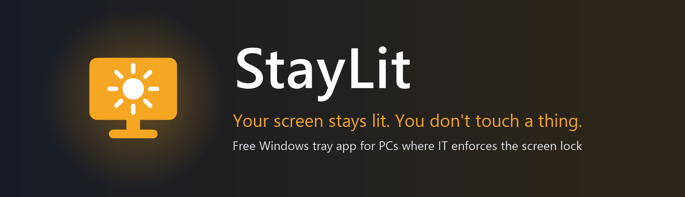
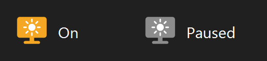
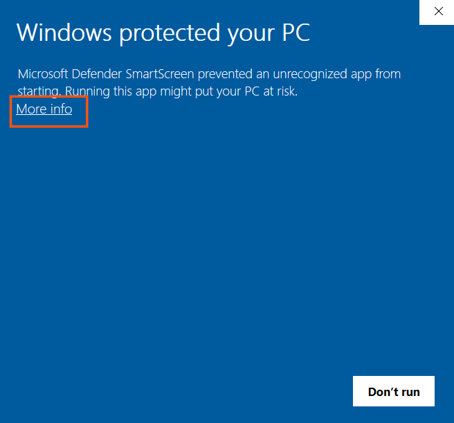
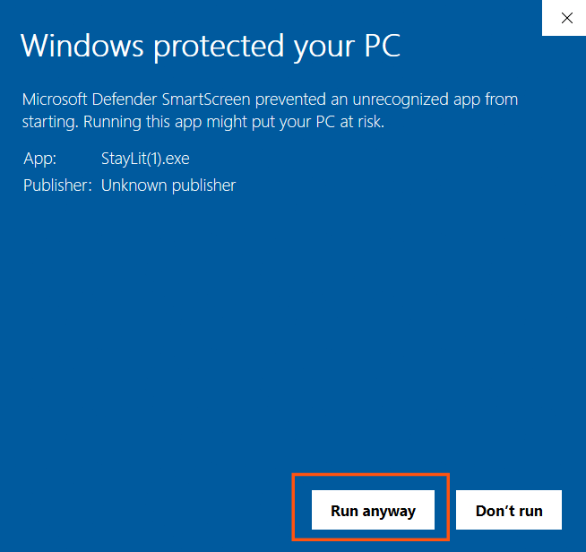
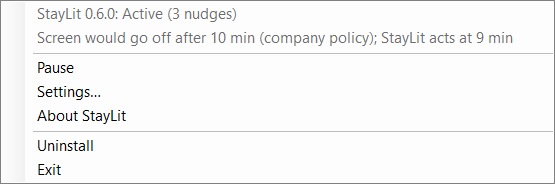
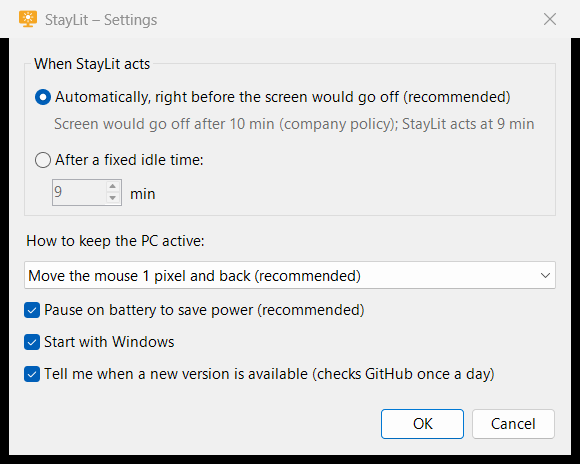

<p align="center">
  <a href="assets/banner.png"></a>
</p>

<h1 align="center">StayLit</h1>

<h2 align="center">KEEPS YOUR SCREEN FROM LOCKING<br>WHILE THE PC IS IDLE</h2>

<p align="center">
  <b>Built for one job:</b> on a PC where IT enforces the screen lock, keep the screen on while a server,
  a long build, a dashboard or a download runs — without you touching anything.
</p>

<p align="center">
  <b>Zero setup.</b> · Finds the lock time by itself. · Does nothing while you work. · No admin rights. · Free.
</p>

## 1. Overview

**StayLit finds out when Windows would lock your screen, and moves the mouse 1 pixel and back right before it.**

Many work PCs lock the screen after a few idle minutes, set by company policy: you cannot change it.
If you leave something running and step away, you come back to a locked screen, a stopped presentation
or a remote session that dropped.
StayLit removes that: it waits until the PC has been idle almost as long as the lock time, then makes one
tiny, invisible move. While you work, it does nothing at all.

### Why use it

- **Nothing to configure.** StayLit reads the lock time from Windows itself — company policy, screen saver
  or power plan — and acts about one minute before it.
- **Invisible.** A 1-pixel move and back: no clicks, no keystrokes in your documents, the pointer stays where it is.
- **Quiet.** It acts only when the PC is idle, once before each lock — not every few seconds.
- **No admin rights.** One double-click installs it for your user. Uninstall leaves nothing behind.
- **Saves your battery.** On battery it pauses by itself, so the screen can lock as usual (you can turn this off).
- **Private.** No data collection. Its only connection: once a day it asks GitHub whether a new version exists.
  The log never contains your user or computer name.
- **Updates with one click.** When a new version is out, StayLit tells you; click the message and it updates itself.

| Without StayLit | With StayLit |
|---|---|
| The screen locks after a few idle minutes | The screen stays on while the PC is idle |
| You set a timer, wiggle the mouse, or keep a video playing | Nothing to do: StayLit acts by itself |
| Generic "mouse jiggler" tools move every 30–60 seconds, also while you type | One tiny move right before the lock, only when the PC is idle |
| Settings to figure out | Zero setup: the lock time is found automatically |

**Three steps:** download `StayLit.exe` → double-click it → done. StayLit runs next to the clock and starts with Windows.

### Features

- Detects the lock time from: the screen saver set by company policy or by you, the machine inactivity limit,
  and the "turn off the display" and "sleep" times of the power plan for the current power source. The shortest one counts.
- Checks again every 5 minutes and when you plug in or unplug the PC.
- Tray icon: **amber** = on, **grey** = paused. Hover it to see the version and the last nudge.
- Pause and resume with one click.
- Optional: a fixed idle time instead of the detected one, and F15 (a key regular keyboards don't have) instead of the mouse move.
- Installs, updates and uninstalls itself, for the current user only.

<p align="center">
  
</p>

## 2. Requirements

- Windows 10 (version 1903 or later) or Windows 11
- .NET Framework 4.8 — already part of these Windows versions

No administrator rights and no extra runtime are needed. Internet access is used only to tell you about new versions
(and to download one when you click); StayLit works fully without it.

## 3. Installation

### Download (recommended)

1. Download **StayLit.exe** from the [latest release](https://github.com/DomitorAI/staylit/releases/latest).
2. Double-click **StayLit.exe** (in your **Downloads** folder).
3. Windows may show a blue **Windows protected your PC** window, because StayLit is new and not yet known
   to Microsoft Defender SmartScreen. Press **More info**:

<p align="center">
  
</p>

4. Press **Run anyway**:

<p align="center">
  
</p>

This window appears once, for a file downloaded from the internet. If your browser renamed the file
(for example `StayLit(1).exe`), that is fine.

**You should see:** the message **StayLit is installed** next to the clock, and the StayLit icon in the
notification area (it may be under the **^** arrow).

StayLit is installed in `%LOCALAPPDATA%\Programs\StayLit\`, with a shortcut on the Desktop and in the Start menu,
and an entry in **Settings → Apps**. It starts with Windows.

**Your browser warns about the download?** Some browsers and Google Drive warn about any `.exe` file they
cannot scan. Choose **Keep** / **Download anyway**.

### Command line

Press **Win+R**, type `cmd`, press **Enter**, then paste this line and press **Enter**:

```bat
curl -L -o "%USERPROFILE%\Downloads\StayLit.exe" https://github.com/DomitorAI/staylit/releases/latest/download/StayLit.exe && "%USERPROFILE%\Downloads\StayLit.exe"
```

A file downloaded this way does not get the SmartScreen window.

### Check the file (optional)

Every release lists the SHA-256 checksum of `StayLit.exe` (file `StayLit.exe.sha256`). To compare:

```bat
certutil -hashfile "%USERPROFILE%\Downloads\StayLit.exe" SHA256
```

### Coming soon

**Microsoft Store** and **winget** (`winget install DomitorAI.StayLit`). They will be added here once they are available.

## 4. Using StayLit

There is nothing to do: once installed, StayLit works by itself.

Right-click the icon next to the clock for the menu:

<p align="center">
  
</p>

- The first two lines show the status and what StayLit found: here, the company policy locks the screen after
  10 minutes, so StayLit acts after 9 idle minutes.
- **Pause** / **Resume** — let the screen lock as usual, for example before a meeting.
- **Settings…** — see [Settings](#5-settings).
- **About StayLit** — version, license and where the log is.
- **Exit** — StayLit stops until the next Windows sign-in (or until you start it from its shortcut).

Double-click the icon to see the status and the number of nudges.

## 5. Settings

<p align="center">
  
</p>

| Setting | What it does |
|---|---|
| **Automatically** (default) | StayLit acts right before the detected lock time. Recommended. |
| **After a fixed idle time** | StayLit acts after the minutes you choose. If that is longer than the lock time, the window warns you. |
| **How to keep the PC active** | Move the mouse 1 pixel and back (default), or press F15. Try F15 if a program reacts to the mouse move. |
| **Pause on battery** (default: on) | On battery the screen can lock as usual, to save power. StayLit resumes when you plug in. |
| **Start with Windows** (default: on) | StayLit starts when you sign in. |
| **Tell me when a new version is available** (default: on) | Once a day StayLit asks GitHub for the latest version. Turn it off if your company does not allow it. |

Settings are kept when you update StayLit and removed when you uninstall it.

## 6. How it works

1. StayLit reads, without changing them, the Windows settings that lock or turn off the screen.
2. It takes the shortest one and plans to act 1 minute before it (for lock times under 3 minutes: a third of
   the time before).
3. About every 20 seconds it asks Windows how long the PC has been idle. While you work, the idle time stays near
   zero and StayLit does nothing.
4. When the idle time reaches the planned moment, StayLit moves the mouse 1 pixel and back (or presses F15).
   Windows counts this as activity and starts its countdown again.

StayLit acts once per lock period. Over an hour of idle time with a 10-minute lock, that is 6 or 7 tiny moves.

## 7. Privacy and security

- **One connection only.** Once a day StayLit asks GitHub (`api.github.com`) for the number of the latest version —
  the request carries no information about you. It downloads a new version **only when you click** the
  notification, from this repository's releases over HTTPS, and checks it (SHA-256, publisher, version) before
  installing it. No telemetry. You can turn the check off in **Settings**.
- **No data collection.** Nothing about you or your PC leaves your computer.
- **Reads, never changes** the Windows settings it checks.
- **Log without personal data:** `%LOCALAPPDATA%\StayLit\log.txt` records when StayLit acted, what it detected and
  when the screen locked or turned off. Paths are written as `%LOCALAPPDATA%` / `%USERPROFILE%`, so the log
  contains neither your user name nor your computer name. You can share it when asking for help.
- **One small file:** `StayLit.exe` (about 100 KB), no other components.

## 8. Use it responsibly

Screen lock is often a company security policy. **Use StayLit with your IT department's approval.**
While StayLit keeps the screen on, anyone near your PC can use it: lock it yourself (**Win+L**) when you leave.

StayLit does not prevent:
- sleep when the laptop lid is closed;
- restarts by Windows Update;
- a lock you start yourself (**Win+L**) or a lock forced by other security software.

## 9. FAQ and Troubleshooting

**I don't see the StayLit icon.**
It may be hidden under the **^** arrow next to the clock. To keep it visible, drag it next to the clock.

**The screen locked anyway.**
- Is the icon grey? StayLit is paused, or on battery with **Pause on battery** on.
- Open the log (**About StayLit** shows where). The lines `Nudge` show when StayLit acted, and `Session locked`
  or `Display off` show when the screen locked or turned off and how long the PC had been idle.
- If a program reacts badly to the mouse move, choose **F15** in **Settings**.
- Some security software locks the screen by its own rules; StayLit cannot see those. Use a fixed idle time
  shorter than that lock in **Settings**.

**My antivirus blocked StayLit.**
New programs without a long history are sometimes flagged by reputation alone. Check the file against the
SHA-256 of the release, and report it as a false positive to your antivirus vendor. Please also
[open an issue](https://github.com/DomitorAI/staylit/issues/new/choose) so others know.

**Windows says the app "has been blocked by your system administrator" or by Smart App Control.**
Your organization (AppLocker, Windows Defender Application Control) or Smart App Control allows only approved
programs. StayLit cannot and does not try to get around that: ask your IT department. If the block happens only
after installing, StayLit tells you and removes what it installed.

**Does StayLit keep the PC awake when the lid is closed?**
No. Closing the lid follows your Windows power settings.

**Can I run it without installing?**
Yes: `StayLit.exe --portable` runs it from where it is, until you exit it. It does not start with Windows.

## 10. Updates

When a new version is out, StayLit shows **StayLit X.Y.Z is available — Click here to update** next to the clock,
and **Update to StayLit X.Y.Z** at the top of its menu.

1. Click the message (or the menu item).
2. StayLit downloads the new version, checks it, closes and starts the new one — a few seconds.

**You should see:** **StayLit updated to X.Y.Z**. Your settings are kept.

Nothing is downloaded until you click. If the update cannot be downloaded (no internet, a company proxy), the
message says so; you can always download the new **StayLit.exe** from the
[latest release](https://github.com/DomitorAI/staylit/releases/latest) and double-click it — the result is the same.

## 11. Uninstall

Any of these:
- Right-click the StayLit icon → **Uninstall**, and confirm.
- **Settings → Apps → Installed apps → StayLit → Uninstall**.
- Quiet, from the command line: `"%LOCALAPPDATA%\Programs\StayLit\StayLit.exe" --uninstall --silent`

**What is removed:** the program folder, the shortcuts, the start-with-Windows entry, the settings, the log,
and the notes Windows keeps about the program (tray icon settings and similar).

Nothing is left behind.

## 12. Feedback

- [Report a bug or request a feature](https://github.com/DomitorAI/staylit/issues/new/choose)
- **Security vulnerability:** [report it privately](https://github.com/DomitorAI/staylit/security/advisories/new) — never in a public issue ([SECURITY.md](SECURITY.md)).
- Liked it? A ⭐ on the repository helps others find it.

## 13. License

- Free to use without limits: also at work and for your employer or clients, on any number of computers.
- You may share the unmodified `StayLit.exe`, free of charge.
- Selling StayLit, or presenting it — or a modified version — as your own work, needs the author's permission.
- Provided as is, without warranty. Whether and how you use it is your decision, including following your
  company's security policies.

See [LICENSE](LICENSE).

Do you need a permission the license does not cover, or a version made for your needs?
[Open a **Contact request**](https://github.com/DomitorAI/staylit/issues/new?template=contact_request.yml).
Don't write confidential details there, because issues are public. You will get a reply on how to continue privately.

## 14. About

Made by [**DomitorAI**](https://github.com/DomitorAI) — Svatantra Dev (स्वतन्त्र).
